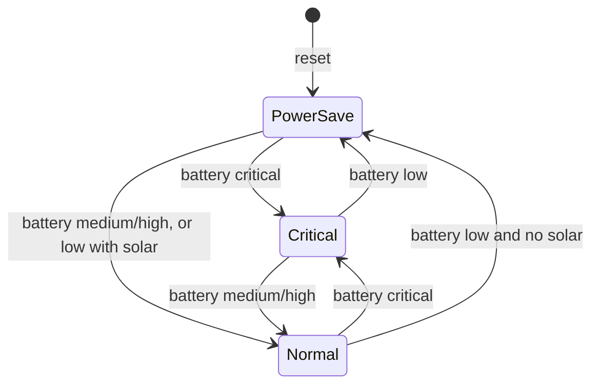

# Solar-Powered Device Energy Manager Using RTL Design

A synthesizable Verilog controller that manages simulated battery energy by selecting **normal**, **power-save**, and **critical** operating modes. Essential loads remain enabled in every mode, while nonessential loads are disabled outside normal mode. Solar charging is enabled whenever solar power is available and the simulated battery is not full.

The design is taken all the way from **RTL to GDSII** using an open-source flow (Yosys, OpenLane/OpenROAD, Sky130).


---

## Table of Contents

1. [Problem Statement](#problem-statement)
2. [Design Overview](#design-overview)
3. [The 13-Step RTL-to-GDS Flow](#the-13-step-rtl-to-gds-flow)
4. [Repository Structure](#repository-structure)
5. [How to Run](#how-to-run)
6. [Results Summary](#results-summary)
7. [Limitations and Future Work](#limitations-and-future-work)
8. [Tools Used](#tools-used)
9. [Author](#author)

---

## Problem Statement

Solar-powered devices need to manage limited energy efficiently. This project designs a simple digital controller that prioritizes essential functions when battery energy is low and restores normal operation when sufficient energy is available.

---

## Design Overview

> The battery level is a **simulated 2-bit category**, not a physical voltage sensor.

### Ports

| Port | Direction | Width | Description |
|---|---|---|---|
| `clk` | input | 1 | System clock |
| `rst_n` | input | 1 | Active-low asynchronous reset |
| `battery_level` | input | 2 | `00` critical, `01` low, `10` medium, `11` high |
| `solar_available` | input | 1 | `1` when usable solar power is available |
| `operating_mode` | output | 2 | `00` normal, `01` power-save, `10` critical |
| `essential_load_enable` | output | 1 | Always `1` in every mode |
| `nonessential_load_enable` | output | 1 | `1` only in normal mode |
| `solar_charge_enable` | output | 1 | `1` when solar is available and battery is not high |

### Operating Modes

| Mode | Encoding | Essential load | Nonessential load |
|---|---|---|---|
| Normal | `00` | ON | ON |
| Power-save | `01` | ON | OFF |
| Critical | `10` | ON | OFF |

### State Transitions

| Current mode | Condition | Next mode |
|---|---|---|
| Normal | battery critical | Critical |
| Normal | battery low and no solar | Power-save |
| Power-save | battery critical | Critical |
| Power-save | battery medium or high | Normal |
| Power-save | battery low and solar available | Normal |
| Critical | battery medium or high | Normal |
| Critical | battery low | Power-save |

Reset starts the controller in **power-save** mode so nonessential loads stay disabled until the battery condition is known.




---

## The 13-Step RTL-to-GDS Flow


### Step 1 — RTL Design

The controller is written in synthesizable Verilog in `solar_energy_manager.v`. It uses a three-block structure: combinational next-state logic, a state register with asynchronous active-low reset, and combinational output-control logic. `solar_energy_manager_top.v` wraps the core for the physical flow.


### Step 2 — Testbench

`tb_solar_energy_manager.v` (core) and `tb_solar_energy_manager_top.v` (top level) drive the design through reset, every battery level, and solar on/off combinations, so that all mode transitions are exercised.


### Step 3 — RTL Simulation

The design is simulated with Icarus Verilog and the waveforms are inspected in GTKWave. The checks confirm correct mode transitions, essential load always enabled, nonessential load enabled only in normal mode, and charging behaviour matching `solar_available` and `battery_level`.


### Step 4 — Synthesis

Yosys maps the RTL onto the Sky130 standard-cell library and produces the gate-level netlist `solar_energy_manager_top_netlist.v`. ABC performs technology mapping and optimization.


### Step 5 — STA (Static Timing Analysis)

Static timing analysis on the synthesized netlist checks setup and hold slack against the target clock constraint, before any layout exists.


### Step 6 — Floorplan

The die and core area, I/O pin placement, and power distribution network (PDN) are defined.


### Step 7 — Placement

Standard cells are placed in rows inside the core area, first globally and then legalized and refined.


### Step 8 — CTS (Clock Tree Synthesis)

A clock tree is built to distribute `clk` to all flip-flops with minimal skew.


### Step 9 — Routing

Global and detailed routing connect all placed cells using the Sky130 metal layers.


### Step 10 — RC Extraction

Parasitic resistance and capacitance are extracted from the routed layout and written out as an SPEF file for accurate timing.


### Step 11 — Post-layout STA

Timing is re-analysed with the extracted parasitics to confirm setup and hold are still met after routing.


### Step 12 — DRC + LVS

- **DRC (Design Rule Check)** verifies the layout obeys Sky130 manufacturing rules.
- **LVS (Layout vs. Schematic)** verifies the layout matches the synthesized netlist.


### Step 13 — GDS

The final layout is exported as a GDSII file, the format handed to a foundry for fabrication.


---

## Repository Structure

```text
Solar-energy-manager/
├── .devcontainer/                      # Dev container setup
├── OpenLane/                           # OpenLane configuration
├── Sky130Tools/                        # Sky130 tool setup
├── physical/                           # Physical design outputs
├── scripts/                            # Helper scripts
├── docs/images/                        # Screenshots used in this README
├── solar_energy_manager.v              # Core RTL
├── solar_energy_manager_top.v          # Top-level wrapper
├── solar_energy_manager_top_netlist.v  # Synthesized gate-level netlist
├── tb_solar_energy_manager.v           # Core testbench
├── tb_solar_energy_manager_top.v       # Top-level testbench
├── Makefile
└── README.md
```

---

## How to Run

### RTL simulation

```bash
iverilog -o a.out solar_energy_manager.v tb_solar_energy_manager.v
vvp a.out
```

If the testbench dumps a VCD file, view it with:

```bash
gtkwave <your_dump>.vcd
```

### Physical design flow

Steps 4 to 13 run through the OpenLane flow using the configuration in `OpenLane/` and the helpers in `scripts/` and the `Makefile`. Open the repository in the provided dev container to get the toolchain pre-configured.

---

## Results Summary

| Metric | Value |
|---|---|
| Cell count after synthesis | _from Yosys statistics (Step 4)_ |
| Setup slack (pre-layout) | _from Step 5 report_ |
| Setup / hold slack (post-layout) | _from Step 11 report_ |
| DRC violations | _from Step 12_ |
| LVS | _from Step 12_ |
| Final output | GDSII (Step 13) |

---

## Limitations and Future Work

- Battery level is a simulated 2-bit category, not a real ADC or voltage reading.
- Only three operating modes are supported.
- Possible extensions: hysteresis or debounce on battery level, more load priority tiers, a real ADC interface, and multi-corner timing sign-off.

---

## Tools Used

| Purpose | Tool |
|---|---|
| RTL simulation | Icarus Verilog, GTKWave |
| Synthesis | Yosys, ABC |
| Place and route, STA | OpenLane / OpenROAD |
| PDK | SkyWater Sky130 |
| DRC / LVS | Magic, Netgen |

---

## Author

**A. Chandan**, B.Tech ECE, Anurag University
