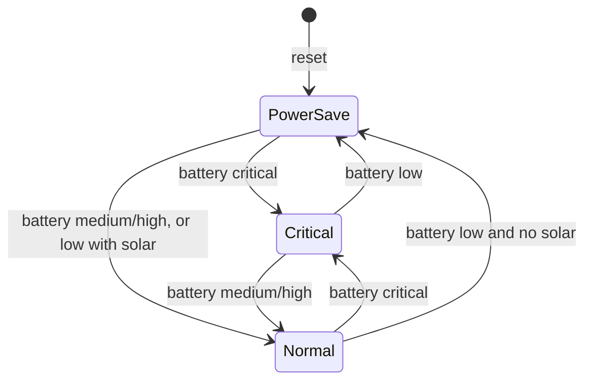
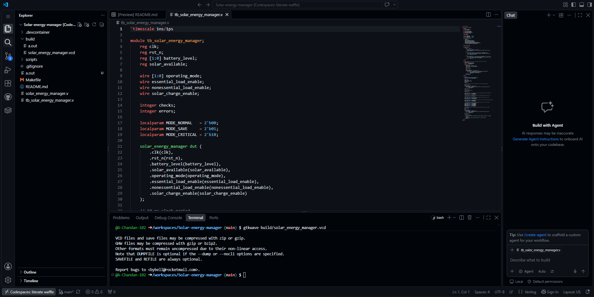
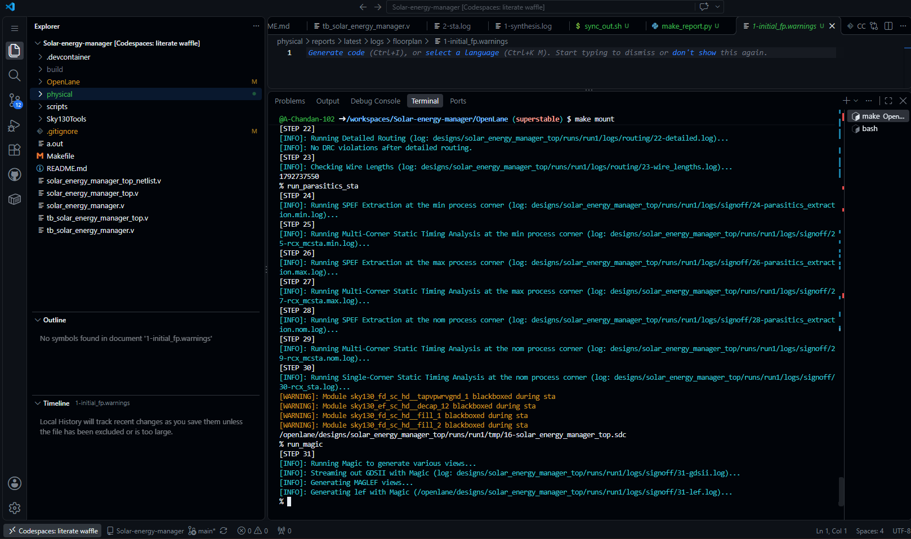
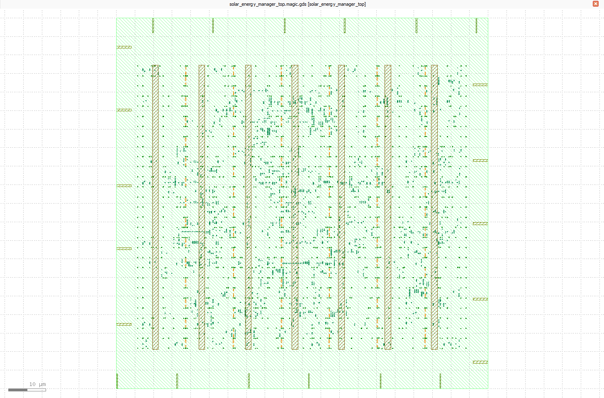
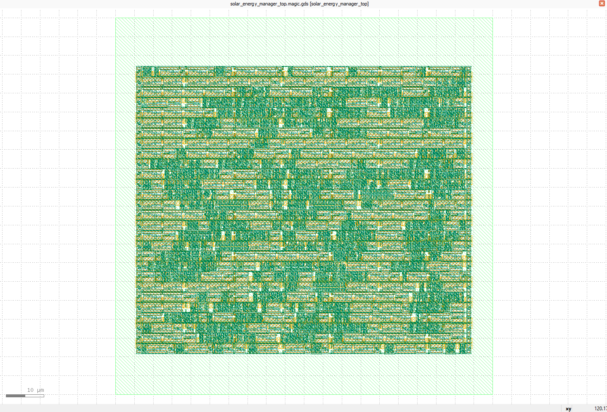
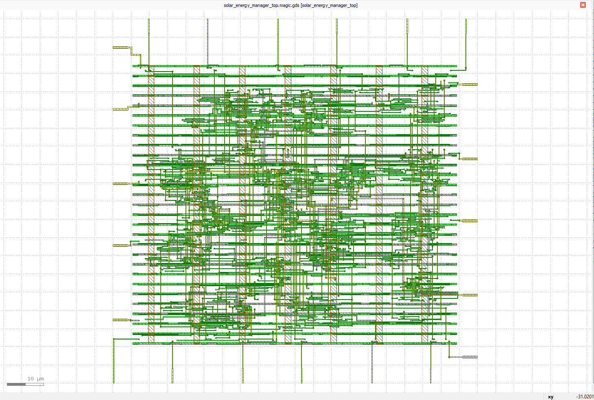

<p align="center">
  
</p>

# Solar-Powered Device Energy Manager Using RTL Design

A synthesizable Verilog controller that manages simulated battery energy by selecting **normal**, **power-save**, and **critical** operating modes. Essential loads remain enabled in every mode, while nonessential loads are disabled outside normal mode. Solar charging is enabled whenever solar power is available and the simulated battery is not full.

The design is taken all the way from **RTL to GDSII** using an open-source flow (Yosys, OpenLane/OpenROAD, Sky130, Magic).

---

## Table of Contents

1. [Problem Statement](#problem-statement)
2. [Design Overview](#design-overview)
3. [Why Both a Core File and a `_top` File](#why-both-a-core-file-and-a-_top-file)
4. [The 13-Step RTL-to-GDS Flow](#the-13-step-rtl-to-gds-flow)
5. [Repository Structure](#repository-structure)
6. [How to Run](#how-to-run)
7. [Results Summary](#results-summary)
8. [Limitations and Future Work](#limitations-and-future-work)
9. [Tools Used](#tools-used)
10. [Author](#author)

---

## Problem Statement

Solar-powered devices need to manage limited energy efficiently. This project designs a simple digital controller that prioritizes essential functions when battery energy is low and restores normal operation when sufficient energy is available.

---

## Design Overview

> The battery level is a **simulated 2-bit category**, not a physical voltage sensor.


### Ports

| Port | Direction | Width | Description |
|---|---|---|---|
| `clk` | input | 1 | System clock |
| `rst_n` | input | 1 | Active-low asynchronous reset |
| `battery_level` | input | 2 | `00` critical, `01` low, `10` medium, `11` high |
| `solar_available` | input | 1 | `1` when usable solar power is available |
| `operating_mode` | output | 2 | `00` normal, `01` power-save, `10` critical |
| `essential_load_enable` | output | 1 | Always `1` in every mode |
| `nonessential_load_enable` | output | 1 | `1` only in normal mode |
| `solar_charge_enable` | output | 1 | `1` when solar is available and battery is not high |

### Operating Modes

| Mode | Encoding | Essential load | Nonessential load |
|---|---|---|---|
| Normal | `00` | ON | ON |
| Power-save | `01` | ON | OFF |
| Critical | `10` | ON | OFF |

### State Transitions

| Current mode | Condition | Next mode |
|---|---|---|
| Normal | battery critical | Critical |
| Normal | battery low and no solar | Power-save |
| Power-save | battery critical | Critical |
| Power-save | battery medium or high | Normal |
| Power-save | battery low and solar available | Normal |
| Critical | battery medium or high | Normal |
| Critical | battery low | Power-save |

Reset starts the controller in **power-save** mode so nonessential loads stay disabled until the battery condition is known.



---

## Why Both a Core File and a `_top` File

The repository contains two parallel sets of files:

| Role | Core design | Top-level wrapper |
|---|---|---|
| RTL | `solar_energy_manager.v` | `solar_energy_manager_top.v` |
| Testbench | `tb_solar_energy_manager.v` | `tb_solar_energy_manager_top.v` |
| Gate-level netlist | n/a | `solar_energy_manager_top_netlist.v` |

The core module holds the controller logic (the FSM and the output logic). The `_top` module instantiates the core and acts as the **chip-level boundary**. They are kept separate for these reasons:

1. **Separation of function from physical integration.** The core is pure behaviour and is verified on its own. The top module is what the physical flow treats as the design: it fixes the pin list, the design name used by synthesis and OpenLane, and the boundary of the die.
2. **Hierarchy before flattening.** Synthesis sees a two-level hierarchy (top, with the core inside). The flow then flattens and cleans it into a single module. The screenshots *Both design hierarchy stats* and *flattened and cleaned stats* show this before and after.
3. **Two levels of verification.** `tb_solar_energy_manager.v` proves the logic is correct in isolation. `tb_solar_energy_manager_top.v` proves the wrapped design behaves identically through the final interface, and the same top-level testbench can be reused against the synthesized netlist to check that synthesis preserved behaviour.
4. **Room to grow without re-verifying the core.** Interface-level additions (for example input synchronizers, pad-related logic, or extra ports for the physical flow) go in the top module. The verified controller logic stays untouched.
5. **Clean naming through the flow.** Every later artifact (netlist, floorplan, placement, routing, GDS) belongs to the top-level module, so results map directly to one design name.


---

## The 13-Step RTL-to-GDS Flow


### Step 1: RTL Design

The controller is written in synthesizable Verilog in `solar_energy_manager.v`. It uses three blocks: combinational next-state logic, a state register with asynchronous active-low reset, and combinational output-control logic. `solar_energy_manager_top.v` wraps the core for the physical flow.


### Step 2: Testbench

`tb_solar_energy_manager.v` (core) and `tb_solar_energy_manager_top.v` (top level) drive the design through reset, the battery levels and solar on/off combinations so the mode transitions are exercised.



### Step 3: RTL Simulation

The design is simulated with Icarus Verilog and the waveforms are inspected in GTKWave. The checks confirm correct mode transitions, essential load always enabled, nonessential load enabled only in normal mode, and charging matching `solar_available` and `battery_level`.

**Core design**


**Top-level design**


### Step 4: Synthesis

Yosys maps the RTL onto the Sky130 standard-cell library and produces the gate-level netlist `solar_energy_manager_top_netlist.v`. ABC performs technology mapping and optimization. The design is synthesized first as a hierarchy, then flattened and cleaned.

**Synthesis statistics**


**ABC results**


**Synthesized netlist**


### Step 5: STA (Static Timing Analysis)

Static timing analysis on the synthesized netlist checks setup and hold slack against the clock constraint, before any layout exists.




### Step 6: Floorplan

The die and core area, I/O pin placement and power distribution network are defined.




### Step 7: Placement

Standard cells are placed in rows inside the core area, first globally and then legalized and refined.



### Step 8: CTS (Clock Tree Synthesis)

A clock tree is built to distribute `clk` to all flip-flops with minimal skew.


### Step 9: Routing

Global and detailed routing connect all placed cells using the Sky130 metal layers.



### Step 10: RC Extraction

Parasitic resistance and capacitance are extracted from the routed layout and written out as an SPEF file for accurate timing.

### Step 11: Post-layout STA

Timing is re-analysed with the extracted parasitics to confirm setup and hold are still met after routing.

### Step 12: DRC + LVS

- **DRC (Design Rule Check)** verifies the layout obeys Sky130 manufacturing rules.
- **LVS (Layout vs. Schematic)** verifies the layout matches the synthesized netlist.


### Step 13: GDS

The final layout is exported as a GDSII file, the format handed to a foundry for fabrication.


---

## Repository Structure

```text
Solar-energy-manager/
├── OpenLane/                           # OpenLane configuration
├── Screenshots/                        # Images used in this README
├── Sky130Tools/                        # Sky130 tool setup
├── build/                              # Build outputs
├── physical/                           # Physical design outputs
├── solar_energy_manager.v              # Core RTL
├── solar_energy_manager_top.v          # Top-level wrapper
├── solar_energy_manager_top_netlist.v  # Synthesized gate-level netlist
├── tb_solar_energy_manager.v           # Core testbench
├── tb_solar_energy_manager_top.v       # Top-level testbench
├── .gitignore
└── README.md
```

---

## How to Run

### RTL simulation

```bash
# Core design
iverilog -o core.out solar_energy_manager.v tb_solar_energy_manager.v
vvp core.out

# Top-level design
iverilog -o top.out solar_energy_manager.v solar_energy_manager_top.v tb_solar_energy_manager_top.v
vvp top.out
```

If a testbench dumps a VCD file, view it with `gtkwave <your_dump>.vcd`.

### Physical design flow

Steps 4 to 13 run through the synthesis, floorplan, STA and Magic scripts shown in the screenshots (`run_synth`, `run_floorplan`, `run_sta`), using the configuration in `OpenLane/` and `physical/`.

---

## Results Summary

| Metric | Value |
|---|---|
| Cell count after synthesis | _from the Step 4 statistics screenshots_ |
| Timing (pre-layout) | _from the Step 5 reports_ |
| Timing (post-layout) | _from Step 11_ |
| DRC / LVS | _from Step 12_ |
| Final output | GDSII (Step 13) |

---

## Limitations and Future Work

- Battery level is a simulated 2-bit category, not a real ADC or voltage reading.
- Only three operating modes are supported.
- Possible extensions: hysteresis or debounce on battery level, more load priority tiers, a real ADC interface, and wider multi-corner timing sign-off.

---

## Tools Used

| Purpose | Tool |
|---|---|
| RTL simulation | Icarus Verilog, GTKWave |
| Synthesis | Yosys, ABC |
| Place and route, STA | OpenLane / OpenROAD |
| PDK | SkyWater Sky130 |
| DRC / LVS / GDS | Magic, Netgen |

---

## Author

**A. Chandan**, B.Tech ECE, Anurag University
